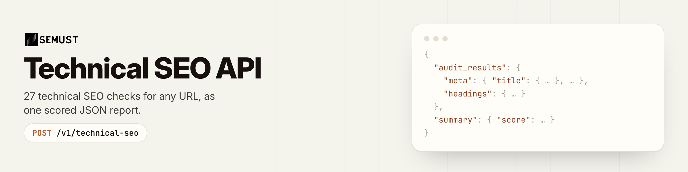
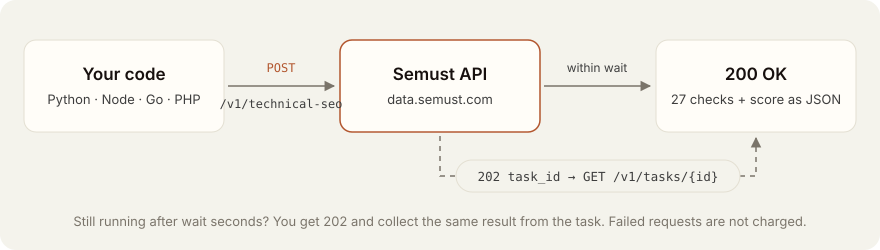
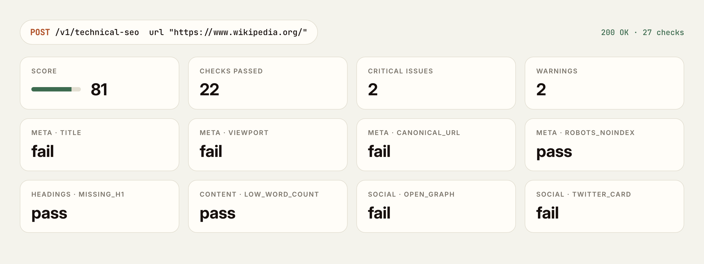

# Technical SEO API

[](https://semust.com/en/api-platform/technical-seo-api?utm_source=github&utm_medium=referral&utm_campaign=technical-seo-api&utm_content=banner)

[](https://app.semust.com/api/access?utm_source=github&utm_medium=referral&utm_campaign=technical-seo-api&utm_content=badge)
[](https://semust.com/en/docs/api/technical-seo?utm_source=github&utm_medium=referral&utm_campaign=technical-seo-api&utm_content=badge)
[](https://github.com/Semust-com/semust-mcp)
[](LICENSE)

The [Semust Technical SEO API](https://semust.com/en/api-platform/technical-seo-api?utm_source=github&utm_medium=referral&utm_campaign=technical-seo-api&utm_content=intro) audits any URL with 27 technical SEO checks in one call: title and meta description, canonical, robots noindex, viewport, `lang` and hreflang, the H1 and heading structure, links and anchor text, image alt text and dimensions, word count, text-to-HTML ratio, page size, the URL itself, and Open Graph and Twitter Card tags. Every check comes back with a pass or fail, a severity, an issue code and the data behind it, plus a 0–100 score. No crawler to host and no HTML parsing on your side.

It is built for SEO teams, agencies and developers who need **site audits at scale, pre-launch and deployment checks, client reporting and SEO data for AI agents**. The API is part of the [Semust](https://semust.com/en?utm_source=github&utm_medium=referral&utm_campaign=technical-seo-api&utm_content=intro) SEO platform.

- [How it works](#how-it-works)
- [Request parameters](#request-parameters)
- [Output sample](#output-sample)
- [JSON output structure](#json-output-structure)
- [Errors](#errors)
- [Pricing](#pricing)
- [Use cases](#use-cases)
- [FAQ](#faq)

## How it works

<picture>
  <source media="(prefers-color-scheme: dark)" srcset="images/how-it-works-dark.svg">
  
</picture>

### 1. Get your API credentials

Create an API user on the [Semust API access page](https://app.semust.com/api/access?utm_source=github&utm_medium=referral&utm_campaign=technical-seo-api&utm_content=credentials). You get a username and a password. Every request sends them as two headers:

| Header | Value |
| --- | --- |
| `SEMUST-API-USER` | Your API username |
| `SEMUST-API-PASSWORD` | Your API password |

The examples in this repository read them from environment variables, so they never end up in your code:

```bash
export SEMUST_API_USER="your_username"
export SEMUST_API_PASSWORD="your_password"
```

> [!TIP]
> There is no subscription. You top up a prepaid balance and pay only for successful requests; failed requests are refunded automatically. Prices are on the [Technical SEO API page](https://semust.com/en/api-platform/technical-seo-api?utm_source=github&utm_medium=referral&utm_campaign=technical-seo-api&utm_content=pricing).

### 2. Send a request

```python
import os, time, requests

HEADERS = {
    "SEMUST-API-USER": os.environ["SEMUST_API_USER"],
    "SEMUST-API-PASSWORD": os.environ["SEMUST_API_PASSWORD"],
}

resp = requests.post(
    "https://data.semust.com/v1/technical-seo",
    params={"wait": 60},
    headers=HEADERS,
    json={"url": "https://www.wikipedia.org/"},
    timeout=90,
)
while resp.status_code == 202:  # still running: poll the task
    time.sleep(int(resp.headers.get("Retry-After", 5)))
    resp = requests.get(resp.json()["poll_url"], headers=HEADERS, timeout=30)

report = resp.json()
print("Score:", report["summary"]["score"])
for category, checks in report["audit_results"].items():
    for name, check in checks.items():
        if check["status"] == "fail":
            print(f"[{check['severity']}] {category}.{name}: {check['issue']}")
```

### 3. Run the examples

| Language | File | Run |
| --- | --- | --- |
| Python | [`examples/python/technical_seo.py`](examples/python/technical_seo.py) | `python technical_seo.py https://www.wikipedia.org/` |
| Python, bulk audit to CSV | [`examples/python/bulk_audit.py`](examples/python/bulk_audit.py) | `python bulk_audit.py urls.txt` |
| Node.js 18+ | [`examples/node/technical_seo.mjs`](examples/node/technical_seo.mjs) | `node technical_seo.mjs https://www.wikipedia.org/` |
| Go | [`examples/go/main.go`](examples/go/main.go) | `go run . https://www.wikipedia.org/` |
| PHP | [`examples/php/technical_seo.php`](examples/php/technical_seo.php) | `php technical_seo.php https://www.wikipedia.org/` |
| cURL | [`examples/curl/technical_seo.sh`](examples/curl/technical_seo.sh) | `./technical_seo.sh` |

## Request parameters

`POST https://data.semust.com/v1/technical-seo` with a JSON body:

| Parameter | Type | Default | Description |
| --- | --- | --- | --- |
| `url` **(required)** | string | – | The page to audit, as a full address including `https://` (or `http://`). |
| `proxy_country` | string | – | ISO 3166-1 alpha-2 country code (`US`, `DE`, `TR`, …). The page is fetched from that country, for sites that answer differently or block visitors by location. |

The page's HTML is fetched as a server would receive it, without running JavaScript, and every check runs on that HTML. To audit a page after JavaScript rendering, use the `audit` report of the [Lighthouse & On-Page SEO API](https://semust.com/en/api-platform/on-page-api?utm_source=github&utm_medium=referral&utm_campaign=technical-seo-api&utm_content=params) with `"javascript": true`.

| Query parameter | Default | Description |
| --- | --- | --- |
| `wait` | `60` | Seconds to hold the connection before answering `202`, 0–80. `0` answers `202` at once (fire and collect). |

| Header | Description |
| --- | --- |
| `Idempotency-Key` | Optional, up to 128 characters. Repeating a request with the same key returns the same task and is charged once. |

## Output sample



A shortened response for `{"url": "https://www.wikipedia.org/"}`. Lists are cut to two items; the complete response is in [`output-technical-seo-api.json`](output-technical-seo-api.json).

```json
{
  "success": true,
  "url": "https://www.wikipedia.org/",
  "audit_results": {
    "meta": {
      "meta_description": {
        "status": "pass",
        "severity": "warning",
        "data": {
          "meta_description": "Wikipedia is a free online encyclopedia, created and edited by volunteers around the world and hosted by the Wikimedia Foundation.",
          "length": 130
        }
      },
      "title": {
        "status": "fail",
        "severity": "critical",
        "issue": "short_title",
        "data": {
          "title": "Wikipedia",
          "length": 9
        }
      },
      "canonical_url": {
        "status": "fail",
        "severity": "warning",
        "issue": "missing_canonical",
        "data": {
          "current_url": "https://www.wikipedia.org/",
          "canonical_url": ""
        }
      },
      "robots_noindex": {
        "status": "pass",
        "severity": "critical",
        "data": {}
      },
      "viewport": {
        "status": "fail",
        "severity": "critical",
        "issue": "missing_device_width",
        "data": {
          "content": "initial-scale=1,user-scalable=yes"
        }
      },
      "missing_lang": {
        "status": "pass",
        "severity": "warning",
        "data": {
          "lang": "en"
        }
      },
      "noindex_canonical_conflict": {
        "status": "pass",
        "severity": "critical",
        "data": {
          "has_noindex": false,
          "has_canonical": false
        }
      },
      "hreflang": {
        "status": "pass",
        "severity": "warning",
        "data": {
          "hreflang_count": 0
        }
      }
    },
    "headings": {
      "multiple_h1_tags": {
        "status": "pass",
        "severity": "warning",
        "data": {
          "h1_count": 1,
          "h1_texts": [
            "WikipediaThe Free Encyclopedia"
          ]
        }
      },
      "duplicate_h1_tags": {
        "status": "pass",
        "severity": "warning",
        "data": {
          "total_h1_count": 1
        }
      },
      "broken_heading_structure": {
        "status": "pass",
        "severity": "warning",
        "data": {
          "headings": [
            {
              "level": 1,
              "text": "WikipediaThe Free Encyclopedia",
              "highlight": false
            },
            {
              "level": 2,
              "text": "1,000,000+articles",
              "highlight": false
            }
          ],
          "total_count": 8,
          "skipped_levels": 0,
          "empty_headings": 0
        }
      },
      "missing_h1": {
        "status": "pass",
        "severity": "critical",
        "data": {
          "h1_count": 1,
          "h1_text": "WikipediaThe Free Encyclopedia"
        }
      }
    },
    "links": {
      "empty_anchor_text": {
        "status": "pass",
        "severity": "warning",
        "data": {
          "total_links": 384
        }
      },
      "non_descriptive_anchors": {
        "status": "pass",
        "severity": "notice",
        "data": {}
      },
      "internal_links_nofollow": {
        "status": "pass",
        "severity": "warning",
        "data": {}
      },
      "too_many_internal_links": {
        "status": "pass",
        "severity": "warning",
        "data": {
          "internal_link_count": 374,
          "threshold": 3000
        }
      },
      "too_many_external_links": {
        "status": "pass",
        "severity": "warning",
        "data": {
          "external_link_count": 10,
          "threshold": 100
        }
      }
    },
    "images": {
      "images_without_alt": {
        "status": "pass",
        "severity": "warning",
        "data": {
          "total_images": 7
        }
      },
      "missing_image_dimensions": {
        "status": "pass",
        "severity": "warning",
        "data": {
          "total_images": 7
        }
      }
    },
    "content": {
      "low_word_count": {
        "status": "pass",
        "severity": "warning",
        "data": {
          "word_count": 1195,
          "threshold": 200
        }
      },
      "low_html_text_ratio": {
        "status": "pass",
        "severity": "warning",
        "data": {
          "text_to_html_ratio": 14.65,
          "text_length": 8892,
          "html_length": 60687
        }
      },
      "lorem_ipsum": {
        "status": "pass",
        "severity": "notice",
        "data": {}
      },
      "page_size": {
        "status": "pass",
        "severity": "warning",
        "data": {
          "html_size_bytes": 122506,
          "html_size_threshold": 3145728,
          "dom_element_count": 1196,
          "dom_threshold": 1500
        }
      }
    },
    "url_analysis": {
      "http_url": {
        "status": "pass",
        "severity": "critical",
        "data": {
          "scheme": "https"
        }
      },
      "long_url": {
        "status": "pass",
        "severity": "notice",
        "data": {
          "url_length": 26,
          "threshold": 2000
        }
      }
    },
    "social": {
      "open_graph": {
        "status": "fail",
        "severity": "warning",
        "issue": "open_graph_issues",
        "data": {
          "present_tags": {
            "og:title": "Wikipedia, the free encyclopedia",
            "og:description": "Wikipedia is a free online encyclopedia, created and edited by volunteers around the world and hosted by the Wikimedia Foundation.",
            "og:image": "https://upload.wikimedia.org/wikipedia/en/thumb/8/80/Wikipedia-logo-v2.svg/250px-Wikipedia-logo-v2.svg.png",
            "og:type": "website"
          },
          "missing_tags": [
            "og:url"
          ]
        }
      },
      "twitter_card": {
        "status": "fail",
        "severity": "notice",
        "issue": "missing_twitter_card_tags",
        "data": {
          "present_tags": {},
          "missing_tags": [
            "twitter:card",
            "twitter:title"
          ]
        }
      }
    }
  },
  "summary": {
    "total_checks": 27,
    "passed_checks": 22,
    "total_issues": 5,
    "critical_issues": 2,
    "warning_issues": 2,
    "notice_issues": 1,
    "score": 81
  },
  "cost": 0.0012
}
```

## JSON output structure

**Top-level fields**

| Field | Type | Description |
| --- | --- | --- |
| `success` | boolean | `true` when the audit ran. |
| `url` | string | The audited URL, as sent. |
| `audit_results` | object | The 27 checks, grouped by category: `meta`, `headings`, `links`, `images`, `content`, `url_analysis`, `social`. Each category maps a check name to its result. |
| `summary` | object | Totals and the score, below. |
| `cost` | number | What this request cost, in USD. |

**Check result** (`audit_results.<category>.<check>`)

| Field | Type | Description |
| --- | --- | --- |
| `status` | string | `pass` or `fail`; `error` if the check could not run on this page. |
| `severity` | string | `critical`, `warning` or `notice`. |
| `issue` | string | Machine-readable issue code. Only present when `status` is `fail`. |
| `data` | object | What the check measured: the title and its length, the H1 texts, link counts, missing tags, thresholds and so on. Present on passes too. |

**Summary**

| Field | Type | Description |
| --- | --- | --- |
| `total_checks` | integer | Checks run (27). |
| `passed_checks` | integer | Checks that passed. |
| `total_issues` | integer | Checks that failed. |
| `critical_issues`, `warning_issues`, `notice_issues` | integer | Failed checks by severity. |
| `score` | integer | `passed_checks / total_checks × 100`, rounded. |

**The 27 checks**

| Category | Check | Severity | Fails when (`issue`) |
| --- | --- | --- | --- |
| `meta` | `title` | critical | The title is missing (`missing_title`), 10 characters or shorter (`short_title`), or longer than 60 (`long_title`). |
| `meta` | `meta_description` | warning | The meta description is missing, shorter than 50 or longer than 160 characters (`missing_meta_description`, `short_meta_description`, `long_meta_description`). |
| `meta` | `canonical_url` | warning | No canonical (`missing_canonical`), more than one (`multiple_canonicals`), or it points to another URL (`canonical_mismatch`). |
| `meta` | `robots_noindex` | critical | A `robots` or `googlebot` meta tag contains `noindex` (`noindex_detected`). |
| `meta` | `viewport` | critical | The viewport meta tag is missing, empty or has no `width=device-width` (`missing_viewport`, `empty_viewport`, `missing_device_width`). |
| `meta` | `missing_lang` | warning | The `<html>` tag has no `lang` attribute (`missing_lang_attribute`). |
| `meta` | `noindex_canonical_conflict` | critical | The page has both `noindex` and a canonical (`noindex_with_canonical`). |
| `meta` | `hreflang` | warning | hreflang tags have an invalid language code, no `x-default` or no self-reference (`hreflang_issues`). |
| `headings` | `missing_h1` | critical | The page has no H1 (`missing_h1`). |
| `headings` | `multiple_h1_tags` | warning | The page has more than one H1 (`multiple_h1`). |
| `headings` | `duplicate_h1_tags` | warning | Two H1s have the same text (`duplicate_h1`). |
| `headings` | `broken_heading_structure` | warning | A heading level is skipped (H2 to H4) or a heading is empty (`broken_heading_structure`). |
| `links` | `empty_anchor_text` | warning | Links have no text and no accessible label (`empty_anchor_text`). |
| `links` | `non_descriptive_anchors` | notice | Anchor text such as "click here" or "read more", in English and Turkish (`non_descriptive_anchors`). |
| `links` | `internal_links_nofollow` | warning | Internal links carry `rel="nofollow"` (`internal_nofollow`). |
| `links` | `too_many_internal_links` | warning | More than 3,000 internal links (`too_many_internal_links`). |
| `links` | `too_many_external_links` | warning | More than 100 external links (`too_many_external_links`). |
| `images` | `images_without_alt` | warning | Images have no `alt` attribute; an empty `alt=""` for decorative images is fine (`missing_alt_attribute`). |
| `images` | `missing_image_dimensions` | warning | Images have no `width` or `height`, which causes layout shift (`missing_image_dimensions`). |
| `content` | `low_word_count` | warning | Fewer than 200 words of main content, not counting navigation, header and footer (`low_word_count`). |
| `content` | `low_html_text_ratio` | warning | Visible text is less than 10% of the HTML (`low_html_text_ratio`). |
| `content` | `lorem_ipsum` | notice | Placeholder "lorem ipsum" text is on the page (`lorem_ipsum_found`). |
| `content` | `page_size` | warning | The HTML is over 3 MB or has more than 1,500 DOM elements (`large_html`, `too_many_dom_elements`). |
| `url_analysis` | `http_url` | critical | The URL uses `http://` instead of `https://` (`http_url`). |
| `url_analysis` | `long_url` | notice | The URL is longer than 2,000 characters (`long_url`). |
| `social` | `open_graph` | warning | `og:title`, `og:description`, `og:image`, `og:url` or `og:type` is missing, or `og:image` is relative (`open_graph_issues`). |
| `social` | `twitter_card` | notice | `twitter:card`, `twitter:title`, `twitter:description` or `twitter:image` is missing (`missing_twitter_card_tags`). |

## Long-running requests (202 and polling)

Most requests finish in a few seconds and return `200` with the result. If a request is still running after `wait` seconds (60 by default, maximum 80), the API returns `202 Accepted` with a `task_id` instead. Nothing is lost and you are not charged twice:

1. Read `task_id` from the body (also in the `X-Task-Id` header).
2. Wait `Retry-After` seconds.
3. Call `GET https://data.semust.com/v1/tasks/{task_id}` with the same headers until the status is no longer `202`. The final answer is exactly what the original request would have returned.

Every example in [`examples/`](examples) already handles this. Results stay available for 72 hours, and fetching them again is free. Set your HTTP client's read timeout above `wait` (for example `wait + 30` seconds). Send an `Idempotency-Key` header to retry a request safely without paying twice. Details: [Tasks & long-running requests](https://semust.com/en/docs/api/tasks?utm_source=github&utm_medium=referral&utm_campaign=technical-seo-api&utm_content=tasks).

## Errors

Errors return JSON with a readable `error` and a stable `code`. Failed requests are not charged.

| HTTP | `code` | Meaning |
| --- | --- | --- |
| 400 | `INVALID_REQUEST`, `URL_REQUIRED` | The body is malformed, or `url` is missing. |
| 401 | `MISSING_CREDENTIALS`, `INVALID_CREDENTIALS`, `CREDENTIALS_EXPIRED` | Check the two auth headers. |
| 402 | `INSUFFICIENT_CREDITS` | Top up your balance. |
| 403 | `IP_NOT_WHITELISTED` | Your API user only accepts requests from listed IP addresses. |
| 429 | `RATE_LIMIT_EXCEEDED`, `TOO_MANY_PENDING_TASKS` | Per-minute or per-day limit reached, or too many tasks still running. Slow down. |
| 500 | `INTERNAL_ERROR` | Something went wrong on our side. |
| 503 | `TARGET_BLOCKED` | The site refused the request, usually bot protection. Try `proxy_country`, or allow the check on your site. |
| 503 | `TARGET_UNREACHABLE` | The host did not resolve, refused the connection or timed out. Check the address. |
| 503 | `AUDIT_FAILED`, `PROXY_ERROR`, `TIMEOUT` | Temporary failure. Retry with the same `Idempotency-Key`. |

## Pricing

**From $0.0012 per audited URL**, all 27 checks included. There is no charge for errors: blocked, unreachable and failed requests are refunded automatically. Current prices are on the [Technical SEO API page](https://semust.com/en/api-platform/technical-seo-api?utm_source=github&utm_medium=referral&utm_campaign=technical-seo-api&utm_content=pricing).

## Use cases

1. **Site audits at scale.** Run the same 27 checks over every important URL and sort the results by severity. Start from [`bulk_audit.py`](examples/python/bulk_audit.py), which writes one CSV row per URL.
2. **Pre-launch and deployment checks.** Call the API from CI after a release and fail the build when a page gets `noindex`, loses its canonical or its H1.
3. **Monitoring.** Re-audit key landing pages on a schedule and alert when the score drops or a new critical issue appears.
4. **Client reporting and lead generation.** Turn the score and failed checks into an audit report for a client or a prospect's homepage.
5. **AI agents and content workflows.** Give an AI agent the exact title, meta description, headings and missing tags of a page, so its suggestions fix real issues.

## Why Semust

- **Pay as you go.** No monthly plan or minimum commitment for the API. Top up once, pay per successful request, and get failed requests refunded automatically.
- **One account, every SEO dataset.** SERP, keyword data, backlinks, domain research, YouTube, Google Trends, Lighthouse and Google Business data use the same credentials, the same error format and the same task system.
- **Any country, any language.** Localised results for every Google market, including strong coverage of Türkiye and Turkish-language queries.
- **Built for AI workflows.** Plug the same data into Claude, Cursor or ChatGPT with the open-source [Semust MCP server](https://github.com/Semust-com/semust-mcp).

## FAQ

### Which pages can it audit?

Any public page reachable over `http` or `https`. Send the full URL with its scheme. Pages behind a login cannot be audited, and sites with strict bot protection may answer `TARGET_BLOCKED`.

### Does it render JavaScript?

No. The checks run on the HTML the server returns, which is also what search engines read first. For a JavaScript-rendered audit, Lighthouse scores and Core Web Vitals, use the [Lighthouse & On-Page SEO API](https://semust.com/en/api-platform/on-page-api?utm_source=github&utm_medium=referral&utm_campaign=technical-seo-api&utm_content=faq).

### How is the score calculated?

It is the share of the 27 checks that pass, from 0 to 100, rounded. Every check counts the same; use `severity` and `critical_issues` to decide what to fix first.

### Does it crawl my whole site?

No. One request audits one URL. To audit a site, send its URLs one by one (from your sitemap, for example), as [`bulk_audit.py`](examples/python/bulk_audit.py) does.

### Can I check a page as seen from another country?

Yes. Set `proxy_country` to a two-letter country code, and the page is fetched from that country.

### Can I use it from Claude, ChatGPT or Cursor?

Yes. The [Semust MCP server](https://github.com/Semust-com/semust-mcp) connects your Semust account to AI assistants, and the [SEO MCP](https://semust.com/en/features/mcp/seo-mcp?utm_source=github&utm_medium=referral&utm_campaign=technical-seo-api&utm_content=mcp) gives them Search Console, rank tracking, indexing and competitor tools.

## Learn more

- [Technical SEO API documentation](https://semust.com/en/docs/api/technical-seo?utm_source=github&utm_medium=referral&utm_campaign=technical-seo-api&utm_content=learn_more) · [Turkish documentation](https://semust.com/docs/api/technical-seo?utm_source=github&utm_medium=referral&utm_campaign=technical-seo-api&utm_content=learn_more)
- [Technical SEO guide](https://semust.com/en/blog/technical-seo?utm_source=github&utm_medium=referral&utm_campaign=technical-seo-api&utm_content=learn_more) · [Turkish version](https://semust.com/blog/teknik-seo?utm_source=github&utm_medium=referral&utm_campaign=technical-seo-api&utm_content=learn_more)
- [SEO checklist](https://semust.com/en/blog/seo-checklist?utm_source=github&utm_medium=referral&utm_campaign=technical-seo-api&utm_content=learn_more)
- [HTTP status codes explained (Turkish)](https://semust.com/blog/http-durum-kodlari?utm_source=github&utm_medium=referral&utm_campaign=technical-seo-api&utm_content=learn_more)
- [Free technical SEO checker](https://semust.com/en/free-seo-tools/technical-seo?utm_source=github&utm_medium=referral&utm_campaign=technical-seo-api&utm_content=learn_more), [robots.txt tester](https://semust.com/en/free-seo-tools/robots-txt?utm_source=github&utm_medium=referral&utm_campaign=technical-seo-api&utm_content=learn_more) and [redirect checker](https://semust.com/en/free-seo-tools/redirect-checker?utm_source=github&utm_medium=referral&utm_campaign=technical-seo-api&utm_content=learn_more)

## Related repositories

**SEO data APIs**

| Repository | What it does | Product page |
| --- | --- | --- |
| [google-serp-scraper](https://github.com/Semust-com/google-serp-scraper) | Organic results, People Also Ask, AI Overviews, ads and more as JSON | [Google SERP API](https://semust.com/en/api-platform/serp-api?utm_source=github&utm_medium=referral&utm_campaign=technical-seo-api&utm_content=related) |
| [google-images-scraper](https://github.com/Semust-com/google-images-scraper) | Google Images results with titles, source pages and image URLs | [Google Images API](https://semust.com/en/api-platform/google-images-api?utm_source=github&utm_medium=referral&utm_campaign=technical-seo-api&utm_content=related) |
| [youtube-scraper](https://github.com/Semust-com/youtube-scraper) | YouTube search, video details, transcripts and comments | [YouTube API](https://semust.com/en/api-platform/youtube-api?utm_source=github&utm_medium=referral&utm_campaign=technical-seo-api&utm_content=related) |
| [google-trends-scraper](https://github.com/Semust-com/google-trends-scraper) | Interest over time, regions, related queries and demographics | [Google Trends API](https://semust.com/en/api-platform/trends-api?utm_source=github&utm_medium=referral&utm_campaign=technical-seo-api&utm_content=related) |
| [google-business-scraper](https://github.com/Semust-com/google-business-scraper) | Google Business profiles, local search and reviews | [Google Business Data API](https://semust.com/en/api-platform/business-data-api?utm_source=github&utm_medium=referral&utm_campaign=technical-seo-api&utm_content=related) |
| [keyword-research-api](https://github.com/Semust-com/keyword-research-api) | Search volume, CPC, competition, intent and related keywords | [Keyword Research API](https://semust.com/en/api-platform/keyword-research-api?utm_source=github&utm_medium=referral&utm_campaign=technical-seo-api&utm_content=related) |
| [backlinks-api](https://github.com/Semust-com/backlinks-api) | Backlinks, referring domains, anchors and link history | [Backlinks API](https://semust.com/en/api-platform/backlinks-api?utm_source=github&utm_medium=referral&utm_campaign=technical-seo-api&utm_content=related) |
| [domain-research-api](https://github.com/Semust-com/domain-research-api) | Organic keywords, competitors, top pages and keyword gaps for any domain | [Domain Research API](https://semust.com/en/api-platform/domain-research-api?utm_source=github&utm_medium=referral&utm_campaign=technical-seo-api&utm_content=related) |
| [lighthouse-on-page-api](https://github.com/Semust-com/lighthouse-on-page-api) | Lighthouse scores, on-page audits and page content extraction | [Lighthouse & On-Page API](https://semust.com/en/api-platform/on-page-api?utm_source=github&utm_medium=referral&utm_campaign=technical-seo-api&utm_content=related) |

**MCP servers for AI assistants**

| Repository | What it does | Product page |
| --- | --- | --- |
| [semust-mcp](https://github.com/Semust-com/semust-mcp) | One MCP server for Search Console, GA4, Google Ads, rank tracking and social posting | [Semust MCP Server](https://semust.com/en/features/mcp?utm_source=github&utm_medium=referral&utm_campaign=technical-seo-api&utm_content=related) |
| [seo-mcp](https://github.com/Semust-com/seo-mcp) | Search Console, rank tracking, indexing and competitor tools for AI assistants | [SEO MCP](https://semust.com/en/features/mcp/seo-mcp?utm_source=github&utm_medium=referral&utm_campaign=technical-seo-api&utm_content=related) |
| [google-search-console-mcp](https://github.com/Semust-com/google-search-console-mcp) | Ask your AI assistant about clicks, queries and pages | [Google Search Console MCP](https://semust.com/en/features/mcp/google-search-console-mcp?utm_source=github&utm_medium=referral&utm_campaign=technical-seo-api&utm_content=related) |
| [google-analytics-mcp](https://github.com/Semust-com/google-analytics-mcp) | GA4 traffic, channels and conversions in your AI assistant | [Google Analytics MCP](https://semust.com/en/features/mcp/google-analytics-mcp?utm_source=github&utm_medium=referral&utm_campaign=technical-seo-api&utm_content=related) |
| [google-ads-mcp](https://github.com/Semust-com/google-ads-mcp) | Campaigns, search terms and spend in your AI assistant | [Google Ads MCP](https://semust.com/en/features/mcp/google-ads-mcp?utm_source=github&utm_medium=referral&utm_campaign=technical-seo-api&utm_content=related) |
| [rank-tracker-mcp](https://github.com/Semust-com/rank-tracker-mcp) | Keyword rankings and AI-search visibility for AI assistants | [Rank Tracker MCP](https://semust.com/en/features/mcp/rank-tracker-mcp?utm_source=github&utm_medium=referral&utm_campaign=technical-seo-api&utm_content=related) |
| [web-analytics-mcp](https://github.com/Semust-com/web-analytics-mcp) | Privacy-friendly first-party analytics in your AI assistant | [Web Analytics MCP](https://semust.com/en/features/mcp/web-analytics-mcp?utm_source=github&utm_medium=referral&utm_campaign=technical-seo-api&utm_content=related) |
| [bing-webmaster-mcp](https://github.com/Semust-com/bing-webmaster-mcp) | Bing queries, pages, links and crawl issues | [Bing Webmaster MCP](https://semust.com/en/features/mcp/bing-webmaster-mcp?utm_source=github&utm_medium=referral&utm_campaign=technical-seo-api&utm_content=related) |
| [yandex-metrica-mcp](https://github.com/Semust-com/yandex-metrica-mcp) | Yandex Metrica traffic and search phrases | [Yandex Metrica MCP](https://semust.com/en/features/mcp/yandex-metrica-mcp?utm_source=github&utm_medium=referral&utm_campaign=technical-seo-api&utm_content=related) |
| [social-media-mcp](https://github.com/Semust-com/social-media-mcp) | Draft and schedule LinkedIn, Facebook and Instagram posts | [Social Media MCP](https://semust.com/en/features/mcp/social-media-mcp?utm_source=github&utm_medium=referral&utm_campaign=technical-seo-api&utm_content=related) |

## Support

- Email: [destek@semust.com](mailto:destek@semust.com)
- [Contact form](https://semust.com/en/contact?utm_source=github&utm_medium=referral&utm_campaign=technical-seo-api&utm_content=footer)
- [LinkedIn](https://www.linkedin.com/company/semust) · [YouTube](https://www.youtube.com/channel/UCr1u7f20OWeOPKWRhBQwNew) · [Instagram](https://www.instagram.com/trysemust)

Found a problem with an example? [Open an issue](https://github.com/Semust-com/technical-seo-api/issues).

## License

The code examples in this repository are released under the [MIT License](LICENSE). Use of the Semust API is subject to the [Semust Terms of Service](https://semust.com/en/terms-of-service?utm_source=github&utm_medium=referral&utm_campaign=technical-seo-api&utm_content=footer).

